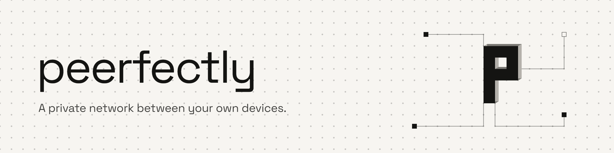

<picture>
  <source media="(prefers-color-scheme: dark)" srcset=".github/assets/banner-dark.png">
  
</picture>

Your devices, on one private network, reachable by name from wherever they are: `nas.home.internal`
from your phone on mobile data, your desktop from your laptop in a hotel. No account to make, no
server that runs your network for you.

> **Status: pre-release (0.4).** Things may still change before 1.0.

## What makes it different

Overlay networks like this are not new. What peerfectly does differently is **who decides who gets
in**.

- **Only your own devices can admit a device.** Every membership change is an operation signed by
  an admin device of your network, and every device checks the signatures itself. There is no
  coordination server that holds a list and could add a key to it.
- **No account.** There is no login, and no identity provider whose compromise would hand someone
  your network. A device's identity is a set of keys it made itself. On Windows and Linux an admin's
  signing key lives in the TPM where there is one, and on a phone in its keystore.
- **The infrastructure can't let anyone in.** The relay (for when two devices can't reach each other
  directly) carries traffic encrypted end to end between your devices, and your devices know it by
  its key, so nothing else can stand in for it. It can't admit a device, read your traffic, or move
  your network somewhere else.
- **It keeps working without us.** The network's rules live in a signed roster that every device
  holds. If the relay you use disappears, devices that can reach each other directly or on the same
  LAN carry on, and an admin can move the network to another relay with a signed change.
- **Admin acts work offline.** Admitting or revoking a device is signed where you are, and spreads to
  the other devices the next time they talk.


## What it is not

- **Not a privacy VPN.** It doesn't hide where you browse and has no exit nodes. It connects *your*
  devices to each other.
- **Not finished.** Today it's built for a person or a household with a handful of devices. Access
  lists per service, sharing between separate people's networks, more than one relay per network,
  recovery when the only admin is lost, macOS and iOS: none of these exist yet.

## How it works, briefly

- **Transport.** [convesso](https://github.com/nohostalgia/convesso), a sibling project: Noise IK
  sessions between devices over UDP, with TCP to the relay where UDP doesn't get through. Devices on
  the same LAN find each other by signed announcements and connect directly. Elsewhere a session
  opens through a relay pinned by its key, and moves to a direct path as soon as the two ends find
  one. peerfectly takes convesso from its repository, fixed to one commit in `Cargo.toml`.
- **The roster.** The membership is a signed, append-only graph of operations (found, admit, revoke,
  change a setting) that any two devices can merge in any order and get the same result. Snapshots
  let it be compacted, and attestations let a device tell that its copy is recent.
- **Admission.** The joining device shows a QR code or a payload. The admin admits it, and both
  screens show a six-digit code you compare before anything is signed.
- **Addresses and names.** Each device gets an IPv6 address derived from its key, plus an IPv4
  address in the CGNAT range. Names resolve under the network's own suffix, `home.internal` by
  default, and only for that suffix: the rest of your DNS is untouched.
- **What a device exposes.** Nothing, until you `expose` a port to one network.

The exact formats are written down next to the code that reads them: see the `FORMAT.md` files under
`crates/`.

## Platforms

| Platform | State |
|---|---|
| Windows 10/11 (x64) | daemon as a service, command line, notification-area icon, MSI installer |
| Linux (x86_64, systemd, glibc 2.34+) | daemon as a systemd service, command line, install script |
| Android | a client exists; it is not in this repository |
| macOS, iOS | not yet |

## Trying it

### Install

Download the package for your machine from the
[Releases](https://github.com/nohostalgia/peerfectly/releases) page, together with `SHA256SUMS`.

**Windows.** Run the `.msi`. It isn't code-signed yet, so SmartScreen will warn that the publisher
is unknown: *More info → Run anyway*.

**Linux.** Unpack the archive and run its install script:

```sh
tar xzf peerfectly-0.4.0-linux-x86_64.tar.gz
sudo ./peerfectly-0.4.0-linux-x86_64/install.sh
```

The script checks everything it needs before it writes anything, and tells you which packages are
missing.

**Checking what you downloaded.** Before you install, compare the file's digest with its line in
`SHA256SUMS`: `sha256sum -c SHA256SUMS --ignore-missing` on Linux, or
`(Get-FileHash <file>).Hash` on Windows, which prints the same digest in capitals.

Every package also carries a provenance attestation: a record, signed by GitHub, of which workflow
built it, from which commit, on which runner. To check that a file came out of this repository's
release workflow and not off someone's laptop, use the [GitHub CLI](https://cli.github.com/):

```sh
gh attestation verify peerfectly-0.4.0-linux-x86_64.tar.gz --repo nohostalgia/peerfectly
```

That tells you where the file was built. It isn't a code signature: Windows doesn't read it, and
it won't quiet SmartScreen.

### A network in four commands

You need a relay. Run your own with [`deploy/server`](deploy/server/README.md), or use one you trust.

On the first device, which becomes the admin:

```sh
peerfectly found home --relay https://relay.example --name laptop
```

It asks the relay's host which key its relay has and asks you to confirm it, then makes the
network's signing key. On Windows that key goes in the TPM, behind Windows Hello. On Linux it goes in the TPM,
or a sealed file where there is none, behind a passphrase.

On the second device:

```sh
peerfectly join --relay https://relay.example --name nas
```

It asks the relay's host the same way, with nothing to confirm, since a join signs nothing with it.
Then it prints a QR code and a payload. Back on the admin:

```sh
peerfectly admit peerfectly-join-v1:…
```

Compare the six digits on both screens, confirm on both, and you're in:

```sh
peerfectly up home
peerfectly peers
```

A device's name is how the others reach it, as `laptop.home.internal`, so it is a DNS label:
lower-case letters, digits and hyphens, at most 63 of them, with no hyphen at either end. Upper case
is lowered, so `Laptop` and `laptop` are the same name. Anything else is refused with a name that
would do. Without `--name`, the machine's name is used, made to fit. An admin renames a device with
`peerfectly rename laptop studio`.

`peerfectly` with no arguments lists every command. On Windows the commands that change the
machine need an elevated console. On Linux, anything that signs needs `sudo`.

A device talks to another only while something is going between them, so the network costs next to
nothing when you're not using it. The trade is a short pause, usually well under a second, on the
first packet after ten minutes of quiet, while the session opens again.

## Building from source

With [rustup](https://rustup.rs/), which installs the Rust that `rust-toolchain.toml` pins, the
one CI and the releases build with:

```sh
cargo build --release -p programs
cargo test --workspace
```

The programs are `peerfectlyd` (the daemon), `peerfectly` (the command line) and, on Windows,
`peerfectly-tray`. On Linux the TPM support links the system's TSS: install `libtss2-dev` (Debian,
Ubuntu) or `tpm2-tss-devel` (Fedora) to build, and `nftables` to run.

The packages are built by the same scripts the release workflow runs:
`.\deploy\windows\package.ps1` writes the `.msi` to `target\dist\`, and `deploy/linux/package.sh`
(it needs Docker) writes the Linux archive there. Both add their line to `target/dist/SHA256SUMS`.

## Finding your way around

| Where | What |
|---|---|
| `crates/roster` | the signed roster: operations, merge, snapshots, attestations |
| `crates/identity` | device keys, and how they're stored |
| `crates/enrollment` | joining: the payload, the code, the exchange |
| `crates/transport`, `crates/transport-convesso` | sessions between devices: the interface, and its implementation on [convesso](https://github.com/nohostalgia/convesso) |
| `crates/tunnel` | the packet path, and the check that a packet comes from who it says |
| `crates/roster-sync`, `crates/local-discovery` | how devices stay in sync, and find each other on the LAN |
| `crates/relay-server` | `peerfectly-relay`: the relay, and the HTTPS answer that tells a device its key |
| `crates/daemon` | the node as a program: it decides, it never touches the machine |
| `crates/windows-daemon`, `crates/linux-daemon` | the parts that touch the machine |
| `crates/cli`, `crates/programs` | the command line and the binaries |
| `deploy/` | installers, the systemd unit, the relay container |
| `DESIGN.md` | the principles the code is built on, and why; comments cite its sections as `§2.6c` |

## License

peerfectly is free software under the [GNU Affero General Public License v3.0 or later](LICENSE).

In plain words: use it, change it, run it at home or on your own server as much as you like. If you
ship it inside a product, or offer a modified version to other people over a network, you have to
offer them your source under the same licence.

If that doesn't work for what you're building, a commercial licence is possible. Open a
[discussion](https://github.com/nohostalgia/peerfectly/discussions) and say what you have in mind.

The name "peerfectly" and its logo are not part of that licence: a modified version you distribute
needs a name and a logo of its own. [TRADEMARKS.md](TRADEMARKS.md) says what you may and may not do
with them.

## Contributing

Issues and pull requests are welcome. Read [CONTRIBUTING.md](CONTRIBUTING.md) first: in short, you'll
be asked to sign a contributor licence agreement ([CLA.md](CLA.md)) once, before your first pull
request is merged.

## Security

Please don't open a public issue for a vulnerability. [SECURITY.md](SECURITY.md) says how to report
one privately.
